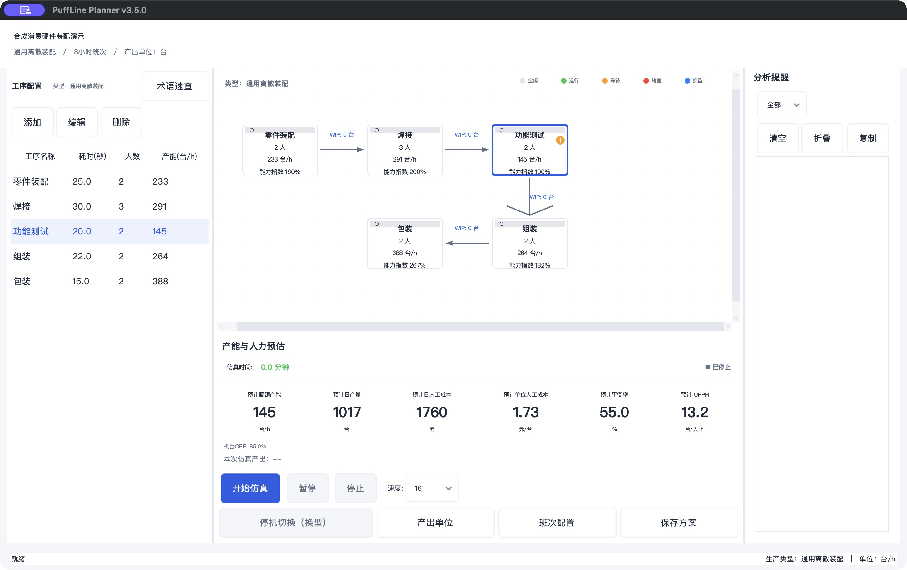

  <a href="https://github.com/MaxHou-infinity/puffline-planner/releases/latest"><strong>下载最新版</strong></a>
  ·
  <a href="#从产线数据到决策材料"><strong>查看工作流程</strong></a>
  ·
  <a href="docs/user-guide.md"><strong>阅读使用指南</strong></a>

  
  
  
  
  

# PuffLine Planner

**在投入现场试错前，判断这条线理论上能不能扛：产能、瓶颈，以及加人、节拍、OEE 试算。**

PuffLine Planner 是面向 IE 的产线预评估工具，不是 PMC 排产或 MRP。它不回答「这张单能不能交」：没有订单、MPS 或交期承诺。覆盖通用离散装配、液体批次和机台包装三种生产形态，把工序节拍、设备效率、WIP、人力和成本放进同一个可重复试算的模型中。

主路径是：打开配置 → **计算本班结果** → 看瓶颈与报告。墙钟动画（「开始仿真」）是可选演示，不改变计算口径。

> 当前版本为 **v3.5.0 Public Beta**，安装包见 [Releases 页面](https://github.com/MaxHou-infinity/puffline-planner/releases/tag/v3.5.0)。仿真结果用于方案预评估，不替代现场测时、工艺验证、质量验证或法规合规判断。

## 它帮助你回答什么

| 决策场景 | PuffLine Planner 给出的结果 |
|---|---|
| 这条线理论上能不能扛？ | 预计产能、瓶颈、平衡率，以及加人 / 节拍 / OEE 试算 |
| 新线或改线前，哪里会先形成瓶颈？ | 工序产能、WIP、饥饿/堵塞、瓶颈与失衡方向 |
| 加人、提 OEE、缩短节拍，哪个动作更有效？ | 敏感性试算、批量方案对比、算法辅助优化 |
| 目标产量需要多少人，缺口何时出现？ | 岗位人数、班次、人力成本、招聘缺口与爬坡达产 |
| 如何把分析结果交给业务团队？ | Excel/PDF 报告、方案对比、KPI 历史与可复制结果表 |
| 这张单能不能交？ | **不回答。** 没有订单、MPS 或交期承诺 |

## 从产线数据到决策材料

~~~mermaid
flowchart LR
    A["打开配置或向导"] --> B["计算本班结果"]
    B --> C["看瓶颈、报警与报告"]
    C --> D["可选：加人、节拍、OEE 试算"]
    D -->|继续试算| B
    C --> F["导出 Excel / PDF"]
    E["可选：墙钟动画演示"] -.-> B
~~~

## 适用流程与模板

v3.5.0 面向消费类硬件装配的产能与人力方案预评估。通用合成模板支持
零件装配、焊接、功能测试、组装与包装；参数须用现场测时校准。

| 执行模型 | 默认单位 | 能力边界 |
|---|---|---|
| 离散装配 | 件（可改为台、套等标签） | 顺序工序、人工/机台、组件库存、质量门和原工序返工 |
| 液体批次 | 千克 | 配方批次与储罐近似模型，非逐设备排程。配方、罐容、换型矩阵只读，修改请用 Excel 模板再导入 |
| 机台包装 | 件 | 与离散工序共用引擎，兼容旧包装模型标识 |

暂不支持多分支汇合、混线产品路由、共享人机资源、凑批老化或独立返修路线。
单位设置只改变标签，不执行件/箱换算或质量/体积换算。
开发范围、阶段记录和验证见 [v3.5.0 路线图](docs/roadmap-v3.5.0.md)。

## 当前版本功能特点

- **三种执行模型**：离散装配、液体批次、机台包装。
- **计算本班结果**：主路径是打开配置后立刻算本班，再看瓶颈与报告；「开始仿真」只是可选墙钟动画。
- **瓶颈与 WIP**：工序运行、等待、堵塞、饥饿和失衡方向。
- **人力**：按目标产量反推人数、班次、人力成本、招聘缺口和爬坡达产。
- **敏感性与方案对比**：加人、节拍、OEE 试算，批量参数网格和遗传算法辅助优化。
- **Excel / PDF 报告**：多方案对比、KPI 历史和可复制结果表。
- **IE 预评估边界**：回答这条线理论上能不能扛；不回答这张单能不能交，没有订单、MPS 或交期承诺。

## 快速开始

### 方式一：下载桌面版

前往 [GitHub Releases](https://github.com/MaxHou-infinity/puffline-planner/releases/latest)，选择 macOS、Windows 或源码压缩包。

> 历史 v3.3.2 安装包文件名仍是 `E-Pod-Line-Simulator`，v3.3.3 起为 `PuffLine-Planner`。
>
> macOS 当前发布包尚未签名和公证。首次启动如被 Gatekeeper 拦截，请在访达中右键应用并选择“打开”。请只从本仓库 Release 页面下载安装包。

### 方式二：源码运行

~~~bash
git clone https://github.com/MaxHou-infinity/puffline-planner.git
cd puffline-planner/e_pod_line_simulator
python -m pip install -r requirements.txt
python run.py
~~~

开发与测试：

~~~bash
python -m pip install -r requirements-dev.txt
python -m pytest tests -q
~~~

更完整的安装、配置、Excel 导入和 FAQ 请阅读 [用户指南](docs/user-guide.md)。

## 技术栈与质量信号

| 组件 | 用途 |
|---|---|
| Python 3.8+ / Tkinter / ttkbootstrap | 本地桌面应用与现代控件主题 |
| SimPy 4.0+ | 离散事件仿真引擎 |
| pandas / openpyxl | Excel 导入导出 |
| reportlab | PDF 报告 |
| pytest / pytest-cov | 自动化回归与覆盖率检查 |
| GitHub Actions / PyInstaller | CI 与 macOS/Windows 打包 |

项目在本地运行，不需要账号，也不会主动上传产线数据。当前 CI 状态可在 [Actions](https://github.com/MaxHou-infinity/puffline-planner/actions) 查看。

## 文档与参与

- [用户指南](docs/user-guide.md)：安装、工作流、配置、Excel 导入与 FAQ
- [更新日志](CHANGELOG.md)：版本能力与修复记录
- [贡献指南](CONTRIBUTING.md)：开发环境、测试和 Pull Request 要求
- [Issues](https://github.com/MaxHou-infinity/puffline-planner/issues)：Bug、功能建议和使用反馈

## 许可与边界

本项目采用自定义的[署名-授权许可证](LICENSE)，属于 **source-available（源码可用）**：

- 使用、复制或修改时必须保留署名与原始仓库链接；
- 对外发布、分发、销售或用于商业用途前，必须取得作者明确授权；
- 仿真结果不构成产能、成本、质量、安全或合规承诺，实际投产前应完成现场验证。

---

  <strong>Simulate. Optimize. Staff.</strong> 
  Production-line simulation and workforce planning for consumer hardware assembly.

